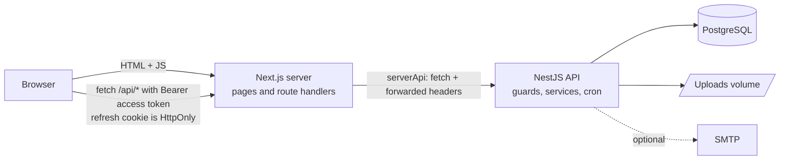
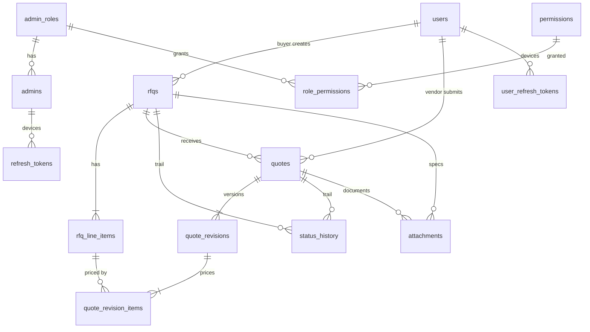

# Bidveda Mini RFQ Portal: system design

A buyer publishes a Request for Quotation, vendors quote before a hard deadline, the buyer compares the
quotes and awards one vendor. This document follows the ten sections the assignment asks for and ends with a
note on where the final build differs from the first design.

---

## 1. Requirement understanding

### The problem in my own words

Procurement by email and spreadsheet loses three things: a **fair deadline**, a **like-for-like comparison**, and
a **record of why a vendor was chosen**. The portal gives each of those a hard rule:

- the deadline is enforced by the server, not by trust;
- every vendor prices the same line items, so quotes line up row by row;
- every status change is stored, and quote revisions are never overwritten.

### Main flows per role

**Buyer**
1. Sign up, sign in.
2. Create an RFQ as a *draft*: title, description, category, line items (name, quantity, unit), delivery location,
   optional budget, deadline, optional PDF/XLSX specifications.
3. Publish it. While it is open it can still be corrected; once a vendor has quoted, its line items are locked, and after the deadline nothing can change.
4. Watch quotes arrive. Open the comparison view, sort by total or delivery time, optionally shortlist.
5. After the deadline, award exactly one quote. The rest are rejected automatically.

**Vendor**
1. Sign up, sign in.
2. Browse open RFQs (keyword, category, location, deadline range, pagination).
3. Open an RFQ, download its specifications, submit a quote: a price per line item, delivery days, notes, files.
4. Revise the quote as often as wanted until the deadline. After it, nothing can be submitted or changed.
5. Follow the quote to its outcome (Submitted, Shortlisted, Accepted or Rejected).

**Admin**
1. Sign in to a separate admin panel.
2. Manage users (create, edit, deactivate), roles and the permission matrix.
3. Read every RFQ, quote, file record and status change. Read the audit log.

### Status machines

```
RFQ    Draft ──publish──▶ Published ──deadline passes──▶ Closed ──award──▶ Awarded
Quote  Submitted ──shortlist──▶ Shortlisted ──award──▶ Accepted
          └────────────award───────────────────────▶ Accepted
       Submitted / Shortlisted ──another quote awarded──▶ Rejected
```

### In scope

Everything in the "Must have" list: auth and roles, RFQ management, quote submission and revision, comparison,
award with history, file upload and download, search and filter with pagination, frontend, relational database with
migrations, automated tests, one-command deployment. Plus: an admin panel with role-based permissions and an audit
log (the optional bonus), email notifications (optional, off unless SMTP is configured), and per-device sessions.

### Out of scope (deliberately)

Re-opening or extending a deadline, withdrawing a quote, multi-currency conversion, organisations with several
staff per company, password reset and email verification, live updates (websockets), reporting and exports,
a notification centre, payments and purchase orders after the award.

---

## 2. Assumptions and open questions

I could not ask questions first, so each unclear point is decided here, with a one-line reason.

| # | Question | Decision | Reason |
|---|----------|----------|--------|
| 1 | Can a vendor see other vendors' quotes? | **No.** A vendor sees only their own quote. The buyer sees all quotes on their own RFQs. | Sealed bids are the fairness guarantee of an RFQ. |
| 2 | What happens to the old version when a vendor revises? | **It is kept.** Every change inserts a new immutable revision; the quote row points to the latest. Submitting identical content creates nothing. | The buyer and the vendor can both see exactly what was offered when. |
| 3 | Can the buyer see quotes before the deadline? | **Yes**, but cannot shortlist or award until the RFQ is closed. | Watching is harmless; deciding before everyone had a chance to revise is not. |
| 4 | Can a published RFQ be edited? | **Yes while it is open, with one limit.** A draft can be edited and deleted. An open RFQ (published, deadline not passed) can be edited, but once a vendor has quoted its **line items are locked**. After the deadline nothing can change. | The buyer must be able to fix a mistake. Quote prices point at the line items, so those cannot change under a vendor; everything else (text, budget, deadline, files) can. |
| 5 | What counts as "after the deadline"? | `deadline <= database clock`. All decisions use PostgreSQL's `clock_timestamp()`, never the browser or app clock. | One authoritative clock, immune to wrong device time. |
| 6 | When does the RFQ become Closed? | A SQL statement moves expired RFQs to Closed and writes a history row. It runs every minute **and** lazily before reads and awards, so correctness never depends on the cron. Submission is refused by the deadline check itself. | Correct to the second even if the scheduler is late. |
| 7 | Is Shortlisted required before Accepted? | **No.** A buyer may award from Submitted or Shortlisted. Shortlisting is an optional marker. | Matches the example in the brief (award straight from the comparison). |
| 8 | One quote per vendor per RFQ? | **Yes** (`UNIQUE (rfq_id, vendor_id)`); changes are revisions. | Prevents a vendor flooding an RFQ. |
| 9 | What happens to the other quotes on award? | Automatically **Rejected**, with a history row each. No undo. | Matches the status flow; a decision should be final and auditable. |
| 10 | What happens to a late quote? | **Refused** with `409 DEADLINE_PASSED`. Nothing is stored or queued. | A queued late quote would be an unfair advantage waiting to happen. |
| 11 | How is money stored? | Integer **minor units** (paise) in `bigint`; one currency per RFQ (INR in the UI). Quantities are `numeric(14,3)`. | Floats cannot add up exactly. |
| 12 | Who is an Admin? | A separate identity in an `admins` table with role-based permissions, created by the Super Admin or the seed. **No public admin sign-up.** | Public sign-up for a privileged role is a hole. Separate table keeps the two token realms apart. |
| 13 | What may an admin do to marketplace data? | **Read everything; edit users only.** RFQs, quotes and history are read-only in the panel. | An admin awarding on a buyer's behalf would undermine the audit trail. |
| 14 | Can users be deleted? | **No**, only deactivated. A deactivated user is locked out on the very next request. | RFQs and quotes must keep a valid owner. |
| 15 | Which files are allowed? | PDF and XLSX, max 10 MB, max 10 per RFQ or quote. Vendor files attach to the quote and lock at the deadline. | The brief says PDF and XLSX are enough. |
| 16 | How are categories and locations modelled? | Fixed category list. Location is structured: country, state, city, pincode (+ optional street). The vendor "location" filter matches any of them. | Structured data filters properly; free text does not. |
| 17 | Can a vendor see an RFQ that is no longer open? | Only if they quoted on it. Other closed RFQs and all drafts are hidden. | Vendors need their own history, not the market's. |
| 18 | Are emails required? | **No.** They are sent best-effort when SMTP is configured and only logged otherwise. They can never fail a request. | The core flow must not depend on a mail server. |

Open questions I would send to the product owner: should quotes be sealed from the buyer until the deadline;
should the buyer be allowed to extend a deadline; how should ties on price be broken; is a minimum number of
quotes required before an award?

---

## 3. Tech stack and reasoning

| Layer | Choice | Why | Considered instead |
|-------|--------|-----|--------------------|
| Frontend | **Next.js 16** (App Router), TypeScript, Tailwind CSS v4, shadcn/ui (Radix), lucide-react | Server-rendered shells, file-based routing, route handlers give a clean place for cookie handling. Required stack. | Vite SPA (no server side for HttpOnly cookies), Remix |
| Frontend libraries | Swiper (swipeable comparison on phones), `react-phone-number-input` (phone with country code), `country-state-city` + `postal-codes-js` (address), `date-fns`; own date/time picker | Libraries named in the project rules; the picker is custom because native pickers cannot be styled consistently. | Native `<input type=date>` |
| Backend | **NestJS 11**, TypeORM 0.3, class-validator | Modules, guards and DI map directly onto roles and permissions. Required stack. | Express by hand, Fastify |
| Database | **PostgreSQL** | Transactions, row locks, CHECK constraints and partial indexes carry the business rules. | MySQL (works, but I wanted `FOR SHARE` / `FOR UPDATE` semantics I know well) |
| Auth | JWT access token (15 min) + refresh token (7 days, stored hashed, one DB row per device) | Per-device sessions, immediate revoke, short blast radius for a leaked access token. | Server sessions, long-lived JWT |
| File storage | Local disk volume behind a `FileStorageService` | Zero infrastructure for the assignment; one class to swap for S3. | S3 / MinIO (see section 10) |
| API docs | Swagger UI at `/api/docs` and a static `docs/openapi.json` | Standard, generated from the code, so it cannot drift. | Hand-written Postman collection |
| Tests | Jest + supertest (API against real PostgreSQL), Vitest (frontend logic) | API-level tests prove the rules; mocks would not. | In-memory database (it hides locking behaviour) |
| Deployment | Docker Compose: `db`, `backend`, `frontend` | One command, same images anywhere. | Platform-specific deploy |

Licence note: `country-state-city` is **GPL-3.0**. It was chosen because the data is local (no network calls) and typed.
For a closed-source commercial release, swap it for a permissively licensed data set; the component
(`AddressFields`) is the only consumer.

---

## 4. Architecture and services



| Component | Responsibility |
|-----------|----------------|
| **Next.js** | Renders page shells (server components). Route handlers are the only thing the browser talks to; they hold the refresh cookie and forward calls. |
| **NestJS API** | Business rules, authorisation, validation, status history, file handling, the minute cron that closes expired RFQs. |
| **PostgreSQL** | Source of truth, row locks that serialise submit vs award, the clock used for every deadline decision. |
| **Uploads volume** | File bytes under random names. Only metadata is in the database. |
| **Background jobs** | One in-process cron (`@nestjs/schedule`). The SQL is idempotent, so running it on several replicas is safe. |
| **Cache** | None on purpose (see section 10). |

### The three-layer API rule (rules.txt)

```
component ─▶ services/*.service.ts ─▶ lib/clientApi.ts ─▶ app/api/**/route.ts ─▶ services-api/*.ts ─▶ lib/serverApi.ts ─▶ NestJS
 (UI)        class-based, no fetch     fetch + interceptor   no logic             class-based, logic     fetch, timeout
```

- `lib/baseApi.ts` is the single place that knows `fetch`, query strings, JSON/FormData and error parsing, with
  `get / post / put / patch / delete`. `ClientApi` and `ServerApi` extend it.
- **Interceptor.** When any call returns 401, `ClientApi` calls the refresh route **once** (parallel 401s share one
  refresh), stores the new access token in memory, then repeats the original request with the same payload. If
  refresh fails too, the app signs the person out.
- **Cookies.** The backend returns the refresh token to the Next.js server only. `SessionAuthApi` puts it in an
  `HttpOnly; SameSite=Lax` cookie and strips it from the body, so page JavaScript can never read it.
- Two completely separate realms (buyer/vendor and admin): separate cookies, separate token audiences, separate routes.

### Admin architecture (admin.txt)

A metadata registry (`backend/src/admin/admin-resource.registry.ts`) declares every admin-visible table once. From it
the system derives the permission rows, the generic CRUD endpoints, FK search, audit logging, the sidebar and every
form and table in the UI. Adding a table is: entity, registry entry, restart.

---

## 5. Database model



Full DDL is in `backend/src/migrations/1760000000000-InitialSchema.ts` (every statement uses `IF NOT EXISTS`, so
tables that already exist are reused, never recreated).

### Marketplace tables

| Table | Key columns | Constraints and indexes |
|-------|-------------|-------------------------|
| `users` | `id uuid`, `email`, `password` (bcrypt), `role` BUYER/VENDOR, `company_name`, `phone` (E.164), `is_active` | `UNIQUE(email)`, `CHECK role` |
| `rfqs` | `buyer_id`, `title`, `description`, `category`, delivery address columns, `budget_minor bigint`, `currency`, `deadline timestamptz`, `status`, `awarded_quote_id` | `CHECK status`, `CHECK budget >= 0`, `INDEX(buyer_id, status)`, `INDEX(status, deadline)`, `INDEX(category)` |
| `rfq_line_items` | `rfq_id`, `position`, `name`, `quantity numeric(14,3)`, `unit` | `UNIQUE(rfq_id, position)`, `CHECK quantity > 0`, cascade delete |
| `quotes` | `rfq_id`, `vendor_id`, `status`, `current_revision_no`, `total_minor`, `delivery_days`, `submitted_at`, `last_revised_at` | **`UNIQUE(rfq_id, vendor_id)`**, `INDEX(rfq_id, total_minor)`, `INDEX(vendor_id)` |
| `quote_revisions` | `quote_id`, `revision_no`, `total_minor`, `delivery_days`, `notes` | `UNIQUE(quote_id, revision_no)`; rows are never updated |
| `quote_revision_items` | `revision_id`, `line_item_id`, `unit_price_minor`, `line_total_minor` | `UNIQUE(revision_id, line_item_id)` |
| `status_history` | `rfq_id`, `quote_id` (null for RFQ events), `from_status`, `to_status`, `actor_type`, `actor_id`, `actor_name`, `note`, `created_at` | both ids are real FKs; `INDEX(rfq_id, created_at)`; append-only |
| `attachments` | `rfq_id` **or** `quote_id`, `uploaded_by`, `original_name`, `stored_name`, `mime_type`, `size_bytes` | **`CHECK ((rfq_id IS NULL) <> (quote_id IS NULL))`**, `UNIQUE(stored_name)` |
| `user_refresh_tokens` | one row per device: `token_hash`, `expires_at`, `is_revoked`, `user_agent`, `ip_address` | `INDEX(user_id)` |

### Access-control tables (admin.txt)

`admins`, `admin_roles` (`is_system` marks Super Admin), `permissions` (one row per resource x create/read/update/delete,
generated from the registry), `role_permissions`, `refresh_tokens` (admin devices), `admin_audit_logs` (append-only; the
admin's name and email are snapshotted so rows survive the account).

### How I store the four things the brief asks about

- **Line items.** A child table, one row per item, with a stable `position`. Quotes reference line items by id, so a
  price can never be attached to an item that is not on that RFQ (also checked in code).
- **Quote revisions.** The `quotes` row is the *current view* (status, latest total, latest delivery days) so the
  comparison can sort in SQL. Every submit or revise also inserts an immutable `quote_revisions` row with its
  `quote_revision_items`. Nothing is overwritten, ever.
- **Status history.** One append-only table for RFQ and quote events, written inside the same transaction as the
  change. `rfq_id` is always set, which makes "everything that happened on this RFQ" a single indexed query.
- **Money.** `bigint` minor units everywhere (API, database, UI). Line total = `round(quantity x unit price)` computed
  on the server and stored, so history never drifts. The browser shows totals for convenience; the server recomputes.

---

## 6. API design

Base path `/api`. Errors always look like `{ statusCode, code, message, details? }`. `code` is stable and machine
readable (for example `DEADLINE_PASSED`). Interactive docs: `/api/docs`; static copy: `docs/openapi.json`.

### Endpoints

| Method | Path | Who | Purpose |
|--------|------|-----|---------|
| POST | `/auth/signup` | public | Create a buyer or vendor and sign in |
| POST | `/auth/login` | public | Sign in, creates a device session |
| POST | `/auth/refresh` | refresh token | New access token |
| POST | `/auth/logout` | refresh token | Revoke that device's session |
| POST | `/auth/logout-all` | Buyer, Vendor | Sign out everywhere |
| GET | `/auth/me` | Buyer, Vendor | Current profile |
| GET / DELETE | `/auth/sessions`, `/auth/sessions/:id` | Buyer, Vendor | List and sign out devices |
| POST | `/auth/admin/login`, `/refresh`, `/logout` | admin | Admin session |
| POST | `/rfqs` | Buyer | Create a draft RFQ |
| GET | `/rfqs` | Buyer, Vendor | Buyer: own RFQs, `status` filter and counts. Vendor: open RFQs, `q`, `category`, `location`, `deadlineFrom/To`, `sort`, pagination |
| GET | `/rfqs/:id` | Buyer (owner), Vendor (open, or already quoted) | Detail with line items and files |
| PATCH | `/rfqs/:id` | Buyer (owner) | Edit a **draft** or an **open** RFQ (deadline not passed); line items replaced if sent, unless a vendor has already quoted (409 `RFQ_LINE_ITEMS_LOCKED`) |
| DELETE | `/rfqs/:id` | Buyer (owner) | Delete a draft |
| POST | `/rfqs/:id/publish` | Buyer (owner) | DRAFT to PUBLISHED |
| GET | `/rfqs/:id/history` | Buyer (all events), Vendor (RFQ events + own quote) | Status trail |
| PUT | `/rfqs/:rfqId/my-quote` | Vendor | Submit or revise (idempotent) |
| GET | `/rfqs/:rfqId/my-quote` | Vendor | My quote with revisions |
| GET | `/rfqs/:rfqId/comparison?sort=` | Buyer (owner) | All quotes side by side; `total_asc/desc`, `delivery_asc/desc`, `submitted_asc` |
| POST | `/rfqs/:rfqId/quotes/:quoteId/shortlist` | Buyer (owner) | SUBMITTED to SHORTLISTED (RFQ must be closed) |
| POST | `/rfqs/:rfqId/award` | Buyer (owner) | Award one quote (RFQ must be closed) |
| GET | `/quotes/mine` | Vendor | My quotes across RFQs, status filter, pagination |
| GET | `/quotes/:id` | Vendor (owner), Buyer (owns the RFQ) | One quote with revisions |
| POST | `/rfqs/:rfqId/attachments` | Buyer (owner) | Upload spec (PDF/XLSX) |
| POST | `/quotes/:quoteId/attachments` | Vendor (owner) | Upload quote document, before the deadline |
| GET | `/attachments/:id/download` | anyone who may see the parent | Download with safe headers |
| DELETE | `/attachments/:id` | uploader | Remove a file, before the lock |
| GET | `/admin/me`, `/admin/resources`, `/admin/dashboard/counts` | any admin | Profile + permissions, UI metadata, counts |
| GET | `/admin/:resource`, `/:resource/options`, `/:resource/:id` | admin with `read` | List (search, sort, page), FK options, one record |
| POST / PATCH / DELETE | `/admin/:resource[/:id]` | admin with `create` / `update` / `delete` | Generic writes, audited |
| POST | `/admin/uploads/images` | any admin | Upload a PNG, JPG or WebP picture (2 MB); returns the name to save on a record |
| GET | `/admin/uploads/images/:name` | any admin | The picture (needs the admin token, so the UI fetches it) |
| GET | `/health` | public | Liveness plus database check |

### Example 1: create an RFQ

`POST /api/rfqs` as a buyer

```json
{
  "title": "Office supplies for Hyderabad site",
  "description": "Chairs and desks for the new site office, delivered and assembled.",
  "category": "Furniture",
  "deliveryCity": "Hyderabad", "deliveryState": "Telangana",
  "deliveryCountry": "India", "deliveryPincode": "500081",
  "budgetMinor": 40000000,
  "deadline": "2026-11-20T11:30:00.000Z",
  "lineItems": [
    { "name": "Chairs", "quantity": 100, "unit": "pcs" },
    { "name": "Desks",  "quantity": 20,  "unit": "pcs" }
  ]
}
```

`201 Created`

```json
{
  "id": "9b0c…", "status": "DRAFT", "title": "Office supplies for Hyderabad site",
  "deadline": "2026-11-20T11:30:00.000Z", "budgetMinor": 40000000, "currency": "INR",
  "lineItems": [
    { "id": "4e1a…", "position": 1, "name": "Chairs", "quantity": 100, "unit": "pcs" },
    { "id": "7c93…", "position": 2, "name": "Desks",  "quantity": 20,  "unit": "pcs" }
  ],
  "attachments": [], "quoteCount": 0, "serverTime": "2026-10-13T09:00:00.000Z"
}
```

### Example 2: submit or revise a quote

`PUT /api/rfqs/9b0c…/my-quote` as a vendor. Prices are per unit, in paise. Chairs 1,900 and desks 8,000:

```json
{
  "items": [
    { "lineItemId": "4e1a…", "unitPriceMinor": 190000 },
    { "lineItemId": "7c93…", "unitPriceMinor": 800000 }
  ],
  "deliveryDays": 10,
  "notes": "Revised chair price."
}
```

`200 OK` (the second call, so `revisionNo` is 2; the total came down from 3,60,000 to 3,50,000)

```json
{
  "id": "c2d8…", "rfqId": "9b0c…", "status": "SUBMITTED",
  "revisionNo": 2, "totalMinor": 35000000, "deliveryDays": 10,
  "items": [
    { "lineItemId": "4e1a…", "unitPriceMinor": 190000, "lineTotalMinor": 19000000 },
    { "lineItemId": "7c93…", "unitPriceMinor": 800000, "lineTotalMinor": 16000000 }
  ],
  "revisions": [
    { "revisionNo": 1, "totalMinor": 36000000, "deliveryDays": 10, "createdAt": "…" },
    { "revisionNo": 2, "totalMinor": 35000000, "deliveryDays": 10, "createdAt": "…" }
  ]
}
```

After the deadline the same call returns `409`:

```json
{ "statusCode": 409, "code": "DEADLINE_PASSED",
  "message": "The submission deadline has passed. Quotes can no longer be submitted or changed.",
  "details": { "deadline": "2026-11-20T11:30:00.000Z" } }
```

### Example 3: award

`POST /api/rfqs/9b0c…/award` as the buyer, after the deadline

```json
{ "quoteId": "f61b…", "note": "Faster delivery outweighs the small price difference." }
```

`200 OK`

```json
{ "rfqId": "9b0c…", "status": "AWARDED", "awardedQuoteId": "f61b…", "awardedAt": "2026-11-20T12:02:11.480Z" }
```

Side effects, all in one transaction: the chosen quote becomes `ACCEPTED`, every other quote `REJECTED`, the RFQ
`AWARDED`, and one `status_history` row is written for each change. A second award returns `409 RFQ_ALREADY_AWARDED`.
Before the deadline: `409 RFQ_NOT_CLOSED`.

---

## 7. Key flows

### Submitting a quote before the deadline

1. Vendor opens `/vendor/rfqs/:id/quote`. The form prices every line, shows a live total and a countdown.
2. The browser calls `PUT /api/rfqs/:id/my-quote` (Next.js route) which forwards to the API with the access token.
3. The API opens a transaction and **share-locks the RFQ row** (`FOR SHARE`).
4. It reads the database clock. If `deadline <= now` it stops here (see next flow).
5. It checks the RFQ is `PUBLISHED`, that every line item is priced exactly once, no unknown ids, no duplicates.
6. It computes each line total and the total from the quantities and unit prices (the client's numbers are not used).
7. It locks this vendor's quote row, then either creates quote + revision 1 (+ history `null to SUBMITTED`) or, if the
   content changed, inserts revision N+1 and updates the quote's current total. If nothing changed it does nothing.
8. Commit. The buyer is emailed (best effort). The response contains the quote and its revision list.

### Rejecting a late quote

Steps 1-4 are the same. At step 4 the clock says `deadline <= now`:

1. The API throws `409 DEADLINE_PASSED` **before reading or writing any quote data**; the transaction rolls back.
2. Nothing is stored, nothing is queued. The vendor's existing quote, if any, is untouched.
3. The same check guards file uploads to a quote and file deletion.
4. The UI shows "The deadline has passed" and returns to the RFQ page. The RFQ flips to `CLOSED` the next time anyone
   reads it (or at the next cron tick), with a `PUBLISHED to CLOSED` history row by `System`.

The check does not depend on the RFQ's stored status, so a deadline that passed a second ago is already enforced
even if the cron has not run.

### Awarding an RFQ

1. Buyer opens the comparison. Awarding is enabled only for a `CLOSED` RFQ.
2. `POST /rfqs/:id/award { quoteId }`.
3. Transaction: **write-lock the RFQ row** (`FOR UPDATE`), then close it if it has just expired.
4. Require status `CLOSED` (`409 RFQ_NOT_CLOSED` / `RFQ_ALREADY_AWARDED` otherwise). Load the RFQ's quotes; the chosen
   id must be one of them (404 otherwise).
5. Chosen quote: `ACCEPTED`. Every other: `REJECTED`. RFQ: `AWARDED` with `awarded_quote_id`. A history row for each.
6. Commit. Vendors are emailed (the losers are not told who won).

Because submissions take a share lock and an award takes an exclusive lock on the same RFQ row, an in-flight
submission finishes before the award reads the quote list, and nothing can slip in afterwards. Two simultaneous
awards: exactly one succeeds, the other gets `409`.

---

## 8. Security and access control

**Roles.** Buyer and vendor endpoints use `@UserAuth(role...)`: `UserJwtGuard` then `RolesGuard`. Admin endpoints use
`@AdminAuth()`: `AdminJwtGuard` then `PermissionGuard`, which maps the `:resource` URL parameter and HTTP method to a
permission (`GET` read, `POST` create, `PATCH/PUT` update, `DELETE` delete) and checks the role's matrix. Super Admin
(a system role) is always allowed. Permissions are generated from the registry on boot.

**One vendor can never read another's data.** Layered, not a single check:
- Quote queries are scoped by `vendor_id = caller`. `GET /quotes/:id` is allowed only for the quote's vendor or the
  buyer who owns its RFQ; anything else is **404, not 403**, so ids cannot be probed.
- The comparison endpoint is buyer-only and loads only RFQs the buyer owns.
- The vendor RFQ list and detail contain `myQuote` only, and never a count or a hint of competing bids.
- The status history endpoint filters quote events to the caller's own quote for vendors.
- Files: a download is allowed only if the caller may see the parent RFQ or quote.
- Covered by tests: *vendor B gets 404 on vendor A's quote and files; a vendor gets 403 on the comparison*.

**Sessions and tokens.**
- Access token 15 minutes, in memory only (never `localStorage`). Refresh token 7 days, `HttpOnly; SameSite=Lax; Secure`
  (when served over HTTPS) cookie set by the Next.js server, **stored hashed** in the database, one row per device.
- Every request re-checks the session row and the user's `is_active`, so logout and deactivation take effect at once.
- Buyer/vendor and admin tokens use different JWT audiences; a token from one realm is rejected by the other.
- Passwords: bcrypt, cost 12. Login does a constant-time dummy comparison for unknown emails.
- Rate limits: 10 requests/minute on login and sign-up, 300/minute globally.

**Input and output.** Global `ValidationPipe` with `whitelist` + `forbidNonWhitelisted`; parameterised queries only; sort
columns come from a whitelist; admin writes accept only fields declared in the registry (no mass assignment); one
error shape, no stack traces; `helmet` headers; CORS limited to the app origin.

**File uploads.**
- Extension must be on the allow-list **and** the first bytes must match (`%PDF-`; XLSX must be a ZIP that contains
  `xl/workbook.xml`). A renamed `.exe` or a text file called `.pdf` is rejected.
- The file is stored under a random UUID name; the client's name is only metadata, stripped of path characters.
- Size limit 10 MB, at most 10 files per RFQ or quote; the content type served back is ours, not the client's.
- Files live outside any static directory and are only reachable through the authorised download endpoint, which sends
  `Content-Disposition: attachment`, `X-Content-Type-Options: nosniff`, `Cache-Control: private, no-store`.

**Admin safety.** Passwords and other secret fields never leave the API and are redacted in the audit log; the Super Admin
role cannot be edited or deleted; you cannot deactivate, delete or demote yourself; the last active Super Admin is protected;
only a Super Admin can assign or change the Super Admin role.

---

## 9. Test cases

Legend: ✅ automated, 🧪 manual (steps in README), ⬜ not done (would add with more time).

Run everything: `cd backend && npm run test:all` and `cd frontend && npm test`.

### Auth and roles

| Case | Status |
|------|--------|
| Sign up buyer/vendor; duplicate email returns 409 `EMAIL_TAKEN`; weak password returns 400 | ✅ e2e |
| Wrong password returns 401 `INVALID_CREDENTIALS`; refresh works; refresh token dies after logout; second device unaffected | ✅ e2e |
| No token returns 401; vendor creating an RFQ returns 403 `FORBIDDEN_ROLE` | ✅ e2e |
| A buyer token is rejected on admin endpoints | ✅ e2e |
| Deactivated user cannot sign in, even with a still-valid token | ✅ e2e |
| Login rate limit returns 429 | ⬜ |
| Expired access token returns 401 and the client refreshes then retries | ✅ unit (client interceptor) |

### RFQ lifecycle

| Case | Status |
|------|--------|
| Draft is invisible to vendors and other buyers (404); buyer edits; publish; vendor now sees it | ✅ e2e |
| An open RFQ can be edited; line items lock at the first quote (409 `RFQ_LINE_ITEMS_LOCKED`); after the deadline 409 `RFQ_NOT_EDITABLE` | ✅ e2e |
| Deadline in the past and empty line items are rejected | ✅ e2e |
| Vendor keyword, category, location filters and pagination; buyer status filter and counts | ✅ e2e |
| Publish a draft whose deadline has already passed returns 400 `DEADLINE_IN_PAST` | ✅ e2e |
| Delete a draft removes its files from disk | ✅ e2e |

### Quotes

| Case | Status |
|------|--------|
| Totals computed server-side; revision 2 keeps revision 1; identical resubmit creates nothing | ✅ e2e |
| Missing price returns `MISSING_LINE_ITEM_PRICE`; foreign line item returns `UNKNOWN_LINE_ITEM` | ✅ e2e |
| Vendor B cannot read vendor A's quote (404), a vendor cannot open the comparison (403), other buyers get 404 | ✅ e2e |
| Late new quote and late revision return 409 `DEADLINE_PASSED`; existing quote unchanged; RFQ reads as CLOSED | ✅ e2e |
| Money arithmetic (chairs 1,900 x 100 + desks 8,000 x 20 = 3,50,000) | ✅ unit |
| Two vendors submit at the same instant as the deadline | ⬜ |
| Same vendor double-submits at once: one quote, one revision, no 500 | ✅ e2e |

### Comparison and award

| Case | Status |
|------|--------|
| Comparison sorts by total and by delivery time | ✅ e2e |
| Award before the deadline returns 409 `RFQ_NOT_CLOSED` | ✅ e2e |
| Award: chosen ACCEPTED, others REJECTED, RFQ AWARDED, full history trail; second award returns 409; vendor 403; outsider 404 | ✅ e2e |
| Vendor sees only RFQ events and their own quote's events; loser sees REJECTED | ✅ e2e |
| Two simultaneous awards: exactly one wins | ✅ e2e |
| Shortlist or award again after the RFQ is awarded returns 409 `RFQ_ALREADY_AWARDED` | ✅ e2e |

### Files

| Case | Status |
|------|--------|
| Real PDF/XLSX accepted; `.exe`, fake PDF, ZIP without a workbook rejected | ✅ e2e + unit |
| Download headers (`nosniff`, attachment); unauthenticated 401; draft file private (404) | ✅ e2e |
| Vendor's quote file hidden from other vendors; upload and delete locked after the deadline | ✅ e2e |
| Path-like stored names refused | ✅ unit |
| Oversize file returns 413 `PAYLOAD_TOO_LARGE` and nothing is stored | ✅ e2e |
| Admin picture: PNG, JPG and WebP accepted by content; SVG, a renamed PDF and a file over 2 MB rejected | ✅ unit |
| Admin picture: another file name or a web address is refused; replacing or removing a picture, or deleting the admin, deletes the old file | 🧪 run by hand against the API |

### Admin

| Case | Status |
|------|--------|
| Super Admin seeded with every permission; metadata lists every registered resource; permission count matches | ✅ e2e |
| Admin edits a user; secrets never returned; deactivated user locked out; marketplace resources read-only (403 `READ_ONLY_RESOURCE`); FK expansion | ✅ e2e |
| Custom role: read-only auditor can read but not write; permission matrix enforced; audit log records the change; passwords redacted | ✅ e2e |
| Super Admin role and last Super Admin protected; cannot deactivate or delete self | ✅ e2e |
| Per-field validation errors | ✅ e2e |
| Admin phone fields require a country code and are normalised to E.164 | ✅ e2e |
| Role editing through the UI matrix | 🧪 |

### Frontend and infrastructure

| Case | Status |
|------|--------|
| Refresh once, replay the same payload and new token; single-flight; sign-out when refresh fails; multipart replay | ✅ unit |
| Proxy: forwards token, relays file headers, refuses `..`, unknown roots, admin sign-in; 502 when the backend is down | ✅ unit |
| Refresh token moved to HttpOnly cookie and removed from the body; admin and user cookies separate; cookie cleared on dead token | ✅ unit |
| Duration, money, redirect-safety and debounce helpers | ✅ unit |
| Comparison highlights (cheapest, fastest, ties) and budget difference | ✅ unit |
| RFQ form rules in zod (title, category, address and pincode, budget, future deadline, line items, unit up to 30 characters) and the payload it sends | ✅ unit |
| Quote form rules in zod, live line totals, the payload it sends | ✅ unit |
| Sign-in and sign-up rules in zod (email, password, optional phone, role) | ✅ unit |
| Date picker maths (month grid, limits, 12-hour clock, default 5:00 PM) | ✅ unit |
| `/` and the sign-in pages route by the role hint cookie; signed-out visitors keep `?next=` | ✅ unit |
| Main components render (RFQ form, quote form, actions per stage, table columns line up, dropdown with a typed-in value) | ✅ unit |
| Whole buyer, vendor and award flow through the Next.js server against an empty database, production mode (34 checks) | 🧪 run by hand before submitting |
| Migration up, down, up | ✅ run manually against PostgreSQL 15 |
| Browser end-to-end (Playwright) across the buyer and vendor journeys | ⬜ |
| Accessibility audit, visual regression | ⬜ |

---

## 10. Scalability and next steps

### What breaks first at 100x load

1. **Per-request session lookup and the lazy `closeExpired` UPDATE on list reads.** Every authenticated request reads a
   session row, and every list read can run an UPDATE. *Change:* cache sessions in Redis with a short TTL and revoke by
   key; stop closing RFQs on reads and rely on the scheduler (the deadline check on writes already makes this safe).
2. **Keyword search** uses `ILIKE '%term%'`, a sequential scan. *Change:* `pg_trgm` GIN indexes, then a search engine
   if relevance matters.
3. **Uploads on one disk.** *Change:* S3-compatible storage with pre-signed URLs, virus scanning, size-based quotas.
   `FileStorageService` is the only class to replace.
4. **Single API instance with an in-process cron.** *Change:* run replicas behind a load balancer (the close statement is
   idempotent; add an advisory lock or move it to a job queue), and put the throttler's counters in Redis.
5. **Connections.** *Change:* PgBouncer, a read replica for lists and the comparison.
6. **Email inside the request path** (fire-and-forget, but in-process). *Change:* a queue with retries.
7. **The Next.js hop.** Each API call goes browser, Next.js, API. *Change:* keep it for cookie safety, but cache
   immutable reads and consider calling the API directly from server components for first paint.

### What I skipped on purpose

Sealed-until-deadline option for buyers, deadline extension, quote withdrawal, multi-currency, organisation accounts,
password reset and email verification, 2FA, websockets, soft delete, report exports.

### What I would do next

1. Playwright journeys for buyer and vendor. 2. Redis for sessions and throttling. 3. S3 and virus scanning.
4. `pg_trgm` search. 5. Cursor pagination for very large lists. 6. Outbox table for emails. 7. Structured logs and metrics.

---

## Changes from the first design

- **Admin as a separate identity.** My first sketch used an `ADMIN` value on `users`. The project's `admin.txt` specifies a
  separate `admins` table with roles and a permission matrix, so I built that. It is a better fit: two token audiences,
  no way to escalate by editing a user's role.
- **Cookie handling moved to the Next.js server.** `admin.txt` has the backend set the refresh cookie; the project rules
  say the frontend stores cookies behind a Next.js route. The backend therefore returns the refresh token to the
  server-side route only, which sets an `HttpOnly` cookie.
- **One frontend app** serves buyers, vendors and admins (admin under `/admin`), instead of the second port in
  `admin.txt`. Separate cookies, tokens and routes keep the sessions apart.
- **Idempotent submit.** Resubmitting identical content creates no new revision (added after thinking about double clicks).
- **Open RFQs can be edited** (assumption 4 changed). The first design locked an RFQ at publishing. Editing is now allowed
  while the RFQ is open; the line items lock at the first quote (the database also forbids deleting a priced line item).
  A closed or awarded RFQ can never be edited.
- **Buyers and vendors have separate pages** (`/buyer/...`, `/vendor/...`) with a guard on each, instead of one shared
  `/rfqs` area that changed shape by role. `/` is not a page: the proxy sends a signed-out visitor to sign-in and a
  signed-in one to their own home.
- **One modal creates and edits an RFQ**, opened from the list and from the RFQ page, instead of separate create and edit
  pages. There is no sidebar for buyers and vendors; a bar on top holds the logo, the role's links and the account menu.
- **Browser-side validation uses zod** (RFQ form, quote form, sign-in, sign-up). The rules live in plain TypeScript files
  with unit tests; the server still validates everything again.
- **Admins can have a picture.** Uploads go to `POST /admin/uploads/images` (PNG, JPG, WebP, 2 MB, checked by content) and are
  served only to signed-in admins. Every admin table is managed on one generic page, `/admin/resources/:resource`.
